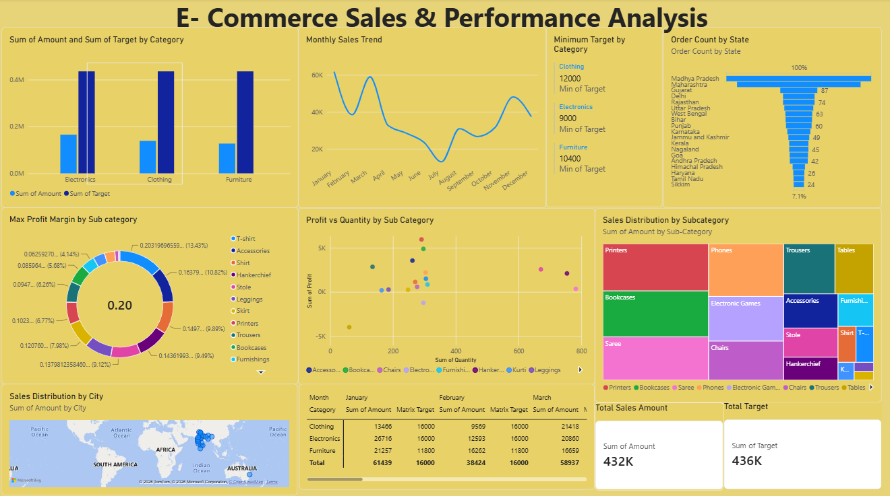

# Power BI Assignments

Welcome to my Power BI Assignments repository!

This repository showcases my hands-on learning and practical assignments in **Microsoft Power BI** as part of my Data Analytics journey. It includes projects focused on data cleaning, data transformation, data modelling and interactive dashboard development.

## 📂 Assignments

### Assignment 1 – E-Commerce Sales Analysis

**Files:**
- `Assignment 1 E-Commerce Sales Analysis.pbix`
- `Assignment 1 Data Transformation and Data Modelling.pdf`

**Key Areas Covered:**
- Data cleaning and preparation
- Data transformation using Power Query
- Data modelling
- E-commerce sales analysis
- Data visualisation and dashboard development

### Assignment 2 – E-Commerce Sales Analysis
### Dashboard Preview

**Files:**
- `Assignment 2 E Commerce Sales Analysis.pbix`
- `Power BI Assignment 2.docx`

**Project Overview:**

An interactive Power BI report developed as part of my practical learning. The project includes data analysis and visualisation to explore the available e-commerce data and present insights through dashboards.

The Power BI report and supporting assignment documentation are included in this repository.

## 🛠️ Tools & Technologies

- Microsoft Power BI
- Power Query
- Microsoft Excel

## 📊 Skills Demonstrated

- Data Cleaning
- Data Transformation
- Data Modelling
- Data Analysis
- Data Visualisation
- Dashboard Development
- Business Intelligence

## 🎯 Objective

To develop practical skills in business intelligence and data analytics by working with datasets, transforming raw data into meaningful information and presenting insights through interactive Power BI dashboards.

## 📌 About This Repository

This repository will be updated as I continue learning and working on new Power BI projects.

Thank you for visiting my repository!
